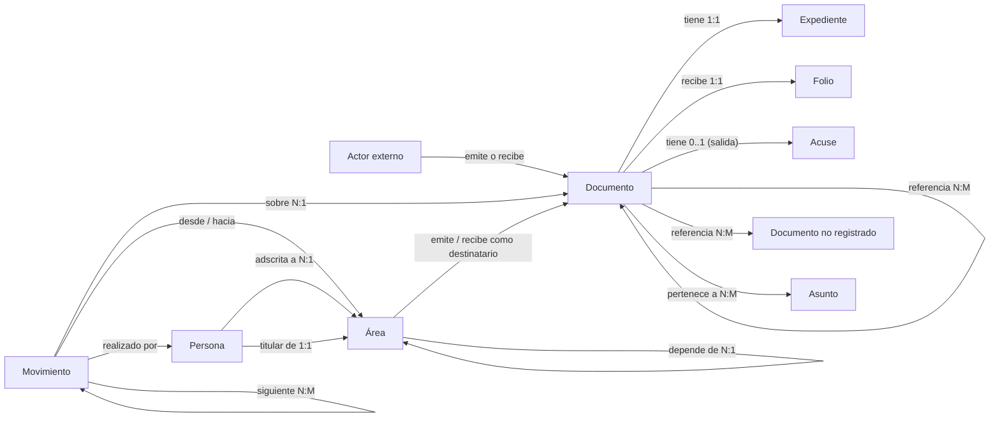

# E-2.1 Modelo conceptual común

Fuentes: conceptos `K-*` del grafo, matriz de propiedad de datos (`docs/arquitectura.md`, sección 5), D-10 a D-16, D-24, D-52, D-100 a D-105.

El modelo sigue al documento (D-02). Cada concepto tiene **una sola base como fuente de verdad**; las otras guardan solo su identificador o una réplica parcial que escribe el outbox (D-13). El mismo UUID identifica al concepto en las tres bases (D-15).

## Conceptos

| Concepto | Qué representa | Fuente de verdad | Réplica |
|---|---|---|---|
| Documento | Registro oficial de una entrada o de una salida externa: tipo (7, D-65), número del emisor, emisor, síntesis, estado, confidencialidad, canal y fechas de recepción | PostgreSQL | Neo4j (id, tipo, estado, confidencial); MongoDB (id y tipo) |
| Expediente | Contenido del documento según su tipo, con anexos y notas | MongoDB | — |
| Folio | Número que asigna el área que registra la entrada o emite la salida; consecutivo por área y año, sin huecos (D-21, D-101) | PostgreSQL | — |
| Acuse | Constancia de que el destinatario externo recibió una salida (O-21) | PostgreSQL | — |
| Movimiento | Cada paso del recorrido: registro, turno, devolución, atracción, conclusión o corrección; bitácora inmutable (D-03, D-11, D-102) | PostgreSQL | Neo4j (réplica completa, unida con SIGUIENTE) |
| Área | Unidad de la organización con titular y área de la que depende; solo estado actual (D-08) | PostgreSQL | Neo4j (id y siglas) |
| Persona | Servidor público; si tiene cuenta, también usuario con rol (D-44) | PostgreSQL | Neo4j (id y nombre) |
| Actor externo | Institución, municipio, proveedor o ciudadano (D-12) | PostgreSQL | — |
| Referencia entre documentos | RESPONDE_A, DA_SEGUIMIENTO_A, EN_ALCANCE_A, SUSTITUYE_A (D-05) | Neo4j | — (salvo la RESPONDE_A de una salida, D-101) |
| Documento no registrado | Documento citado que no está en el sistema: número y emisor en texto (D-33) | Neo4j | — |
| Asunto | Tema de fondo que agrupa documentos (D-24, D-30) | Neo4j | — |

## Relaciones entre conceptos

Cardinalidades clave:

- Un documento tiene exactamente un expediente (`_id = id_documento`, D-16) y exactamente un folio (D-101).
- Un documento tiene 1..N movimientos; el primero es el `registro` (entrada). Una salida no tiene movimientos: su ciclo es registro y acuse.
- SIGUIENTE es N:M: un turno a varias áreas abre ramas y una atracción las reúne (D-09, D-68, D-70).
- Un documento puede pertenecer a varios asuntos (D-30).
- Una persona es titular de a lo más un área y un área tiene a lo más un titular; el puesto puede estar vacante (D-31).

## Dónde vive cada cosa

- **PostgreSQL:** todo lo que exige transacción, unicidad o inmutabilidad: documento, folio, acuse, movimiento, estructura organizacional, actores, usuarios, sesiones, catálogos y outbox.
- **MongoDB:** solo el expediente; los campos propios de cada tipo validados con `$jsonSchema` (D-60, D-66, D-104).
- **Neo4j:** lo que se recorre (movimientos con SIGUIENTE, D-50) y lo que solo existe en el grafo: referencias, documentos no registrados y asuntos (D-24). Las relaciones organizacionales no se replican (D-52).
