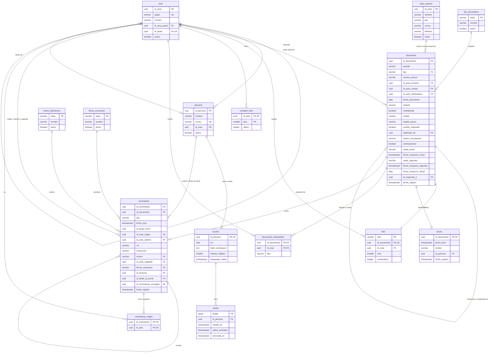

# E-2.2 Modelo lógico relacional (PostgreSQL 17)

Fuentes: D-15, D-18 a D-21, D-26 a D-28, D-31, D-32, D-34, D-42, D-43, D-47, D-49, D-55, D-59, D-61, D-65, D-67, D-68, D-72, D-101, D-102, D-105; patrones AR-01 a AR-11.

Convenciones:

- Identificadores UUID generados por el backend (D-15), salvo `outbox.id` (secuencia, D-48) y las claves de los catálogos (texto).
- `timestamptz` para instantes y `date` para fechas de calendario; la zona de negocio es America/Mexico_City.
- Catálogos administrables con marca `activo` (O-31): `tipo_documento`, `motivo_devolucion`, `forma_conclusion`, `area`, `actor_externo`. Listas cerradas del sistema (D-72) como `CHECK`.
- El esquema se crea con scripts numerados en `database/relational/schema/` y queda en `esquema_version` (D-55). Un script aplicado no se edita.

## Diagrama entidad-relación



Fuera del diagrama, por no tener llaves foráneas: `outbox` y `esquema_version`.

## Tablas

### Estructura organizacional, usuarios y actores

**area** — estado actual, sin vigencias ni sucesión (D-08).

| Columna | Tipo | Nulo | Restricción | Notas |
|---|---|---|---|---|
| id_area | uuid | no | PK | |
| siglas | varchar(10) | no | UNIQUE | Forman el folio; no cambian si el área tiene folios (D-61, disparador) |
| nombre | varchar(200) | no | | |
| id_area_padre | uuid | sí | FK → area; CHECK ≠ id_area | Sin ciclos: consulta recursiva en la transacción con la tabla bloqueada (D-47, AR-09) |
| id_titular | uuid | sí | FK → persona DEFERRABLE; UNIQUE | Nulo = vacante; el titular debe estar adscrito al área (O-33, servicio) |
| activa | boolean | no | DEFAULT true | No se desactiva con pendientes (O-33, servicio) |

**persona**

| Columna | Tipo | Nulo | Restricción | Notas |
|---|---|---|---|---|
| id_persona | uuid | no | PK | |
| nombre | varchar(200) | no | | |
| correo | varchar(150) | sí | UNIQUE sobre `lower(correo)` | Obligatorio si tiene usuario (servicio) |
| id_area | uuid | sí | FK → area | Adscripción |
| activa | boolean | no | DEFAULT true | Baja lógica: conserva sus movimientos (O-34) |

**usuario** — cuenta de una persona (D-105).

| Columna | Tipo | Nulo | Restricción | Notas |
|---|---|---|---|---|
| id_persona | uuid | no | PK, FK → persona | |
| rol | char(2) | no | CHECK IN ('OF','DI','TI','PE','AD') | D-44 |
| hash_contrasena | text | no | | scrypt de la biblioteca estándar (D-107) |
| intentos_fallidos | smallint | no | DEFAULT 0, CHECK ≥ 0 | Bloqueo temporal de O-36 |
| bloqueado_hasta | timestamptz | sí | | |

**sesion** (D-49, AR-08)

| Columna | Tipo | Nulo | Restricción | Notas |
|---|---|---|---|---|
| huella | bytea | no | PK, CHECK octet_length = 32 | SHA-256 del código de la cookie |
| id_persona | uuid | no | FK → usuario | Índice |
| creada_en | timestamptz | no | DEFAULT now() | |
| ultima_actividad | timestamptz | no | DEFAULT now() | Caduca tras `SESION_MINUTOS_INACTIVIDAD` |
| revocada_en | timestamptz | sí | | O-37 |

**actor_externo** (O-35)

| Columna | Tipo | Nulo | Restricción |
|---|---|---|---|
| id_actor | uuid | no | PK |
| nombre | varchar(200) | no | |
| tipo | varchar(11) | no | CHECK IN ('institucion','municipio','proveedor','ciudadano') |
| correo | varchar(150) | sí | |
| telefono | varchar(30) | sí | |
| activo | boolean | no | DEFAULT true; no se elimina si tiene documentos |

### Catálogos (O-31)

| Tabla | Clave (PK) | Filas iniciales |
|---|---|---|
| tipo_documento | clave varchar(30) | oficio, solicitud_material_pago, requerimiento_auditoria, solicitud_transparencia, memorandum, circular, informe (D-65) |
| motivo_devolucion | clave varchar(30) | falta_informacion, falta_firma, falta_anexo, corregir_dato, no_competencia (D-32) |
| forma_conclusion | clave varchar(30) | con_respuesta, atencion_sin_oficio, enterado, no_procede, duplicado (D-59) |

Las tres tienen además `nombre varchar(100) NOT NULL` y `activo boolean NOT NULL DEFAULT true`. Las filas las carga un script versionado; los inactivos se siguen mostrando en documentos antiguos.

### Documento y folio

**documento** — entradas y salidas externas (D-101, D-105).

| Columna | Tipo | Nulo | Restricción | Notas |
|---|---|---|---|---|
| id_documento | uuid | no | PK | Mismo id en MongoDB y Neo4j |
| sentido | varchar(7) | no | CHECK IN ('entrada','salida') | |
| tipo | varchar(30) | no | FK → tipo_documento | Inmutable (D-26, disparador) |
| numero_emisor | varchar(60) | sí | | Obligatorio en salida |
| id_area_emisora | uuid | sí | FK → area | |
| id_actor_emisor | uuid | sí | FK → actor_externo | |
| id_actor_destinatario | uuid | sí | FK → actor_externo | Solo salida |
| fecha_documento | date | sí | | Fecha escrita en el documento |
| sintesis | varchar(500) | no | | D-43; el contrato la expone también como `asunto` |
| confidencial | boolean | no | DEFAULT false | D-29 |
| estado | varchar(10) | no | CHECK IN ('en_tramite','concluido','cancelado','sin_efecto'), DEFAULT 'en_tramite' | |
| estado_previo | varchar(10) | sí | CHECK IN ('en_tramite','concluido') | Solo con `sin_efecto`; O-18 lo devuelve (D-14) |
| posible_duplicado | boolean | no | DEFAULT false | Sin número o sin fecha (D-27) |
| duplicado_de | uuid | sí | FK → documento; CHECK ≠ id_documento | O-26 y forma `duplicado` |
| motivo_cancelacion | varchar(300) | sí | | O-24 |
| extemporaneo | boolean | no | DEFAULT false | D-34 |
| canal_inicial | varchar(6) | sí | CHECK IN ('correo','papel') | Solo entrada |
| fecha_recepcion_inicial | timestamptz | sí | | Solo entrada |
| canal_segunda | varchar(6) | sí | CHECK IN ('correo','papel'), ≠ canal_inicial | O-19 |
| fecha_recepcion_segunda | timestamptz | sí | CHECK ≥ fecha_recepcion_inicial | |
| fecha_recepcion_oficial | date | sí | | Sello en papel o día del correo (D-28) |
| id_responde_a | uuid | sí | FK → documento; CHECK ≠ id_documento | Solo salida (D-101) |
| fecha_registro | timestamptz | no | DEFAULT now() | |

Restricciones de tabla:

- **Entrada** (RI-06): exactamente uno de `id_area_emisora` e `id_actor_emisor`; `canal_inicial`, `fecha_recepcion_inicial` y `fecha_recepcion_oficial` no nulos; `id_actor_destinatario` e `id_responde_a` nulos.
- **Salida**: `id_area_emisora`, `id_actor_destinatario` y `numero_emisor` no nulos; `id_actor_emisor`, canales y fechas de recepción nulos.
- `canal_segunda` y `fecha_recepcion_segunda` son nulos o no nulos a la vez.
- `(estado = 'sin_efecto') = (estado_previo IS NOT NULL)`.
- `estado <> 'cancelado' OR motivo_cancelacion IS NOT NULL`.
- Duplicados (D-27, AR-02): índice único parcial

  ```sql
  CREATE UNIQUE INDEX ux_documento_duplicado ON documento
    (numero_emisor, COALESCE(id_area_emisora, id_actor_emisor), (EXTRACT(YEAR FROM fecha_documento)))
    WHERE sentido = 'entrada' AND numero_emisor IS NOT NULL AND fecha_documento IS NOT NULL;
  ```

**folio** — uno por documento (D-101).

| Columna | Tipo | Nulo | Restricción | Notas |
|---|---|---|---|---|
| folio | varchar(30) | no | PK | `SIGLAS-AAAA-NNNN`, por ejemplo `OP-2026-0153` |
| id_documento | uuid | no | FK → documento, UNIQUE | |
| id_area | uuid | no | FK → area | Área que registra la entrada o emite la salida |
| anio | smallint | no | | Año de registro, no del documento (D-34) |
| consecutivo | integer | no | CHECK > 0 | |

`UNIQUE (id_area, anio, consecutivo)`. Inmutable (disparador).

**contador_folio** (D-21, AR-01) — `(id_area, anio)` PK, `ultimo integer NOT NULL DEFAULT 0`. Se lee con `SELECT … FOR UPDATE` y se actualiza en la misma transacción que inserta el documento y el folio; si la transacción falla, el consecutivo no se consume.

**acuse** (O-21, D-58)

| Columna | Tipo | Nulo | Restricción |
|---|---|---|---|
| id_documento | uuid | no | PK, FK → documento (solo salida, disparador) |
| fecha_hora | timestamptz | no | |
| recibio | varchar(200) | no | Quién firmó de recibido |
| id_persona | uuid | no | FK → persona (quién lo capturó) |
| fecha_registro | timestamptz | no | DEFAULT now() |

**documento_destinatario** (D-04, HU-DEST abierto) — `id_documento` FK, `id_area` FK, `tipo varchar(8) CHECK IN ('dirigido','copia')`, PK `(id_documento, id_area)`. Ninguna operación la llena todavía.

### Bitácora

**movimiento** (D-102, AR-03) — solo INSERT; un disparador rechaza UPDATE y DELETE.

| Columna | Tipo | Nulo | Restricción | Notas |
|---|---|---|---|---|
| id_movimiento | uuid | no | PK | Mismo id en Neo4j |
| id_documento | uuid | no | FK → documento | Solo entradas |
| tipo | varchar(11) | no | CHECK IN ('registro','turno','devolucion','atraccion','conclusion','correccion') | |
| fecha_hora | timestamptz | no | DEFAULT now() | |
| id_grupo_turno | uuid | sí | | D-18 |
| id_area_origen | uuid | sí | FK → area | Nulo solo en `registro` |
| id_area_destino | uuid | no | FK → area | En `conclusion`, el área que concluye |
| rol | varchar(12) | no | CHECK IN ('responsable','apoyo','conocimiento') | |
| instruccion | varchar(500) | sí | | Instrucción, nota de devolución, justificación de atracción, motivo de corrección o folio enlazado al concluir |
| motivo | varchar(30) | sí | FK → motivo_devolucion | |
| id_area_sugerida | uuid | sí | FK → area | |
| forma_conclusion | varchar(30) | sí | FK → forma_conclusion | |
| id_persona | uuid | no | FK → persona | Quien lo realizó |
| id_titular_al_turnar | uuid | sí | FK → persona | D-31; nulo si vacante |
| id_movimiento_corregido | uuid | sí | FK → movimiento | O-25 |
| fecha_registro | timestamptz | no | DEFAULT now() | |

Restricciones por tipo (RI-11):

- `(tipo = 'registro') = (id_area_origen IS NULL)`.
- `(tipo = 'devolucion') = (motivo IS NOT NULL)`.
- `id_area_sugerida IS NULL OR motivo = 'no_competencia'` (D-69).
- `(tipo = 'conclusion') = (forma_conclusion IS NOT NULL)`.
- `(tipo = 'correccion') = (id_movimiento_corregido IS NOT NULL)`.
- `tipo NOT IN ('turno','correccion') OR id_grupo_turno IS NOT NULL`.
- RI-10, «a lo más uno»: `CREATE UNIQUE INDEX ux_responsable_por_grupo ON movimiento (id_grupo_turno) WHERE tipo = 'turno' AND rol = 'responsable'`. «Al menos uno» y las correcciones de rol se validan en el servicio.

Índices: `(id_documento, id_area_destino, fecha_hora)` para la bandeja (AR-06, D-42) y `(id_documento, fecha_hora)` para la ficha y el outbox.

**movimiento_origen** (D-68) — orígenes adicionales de una atracción. PK `(id_movimiento, id_area)`, ambas FK; el área no puede ser la de `id_area_origen` del movimiento. Solo INSERT, y solo para movimientos `atraccion` (disparador).

### Infraestructura

**outbox** (D-13, D-48, AR-04, AR-05)

| Columna | Tipo | Nulo | Restricción |
|---|---|---|---|
| id | bigint | no | PK, GENERATED ALWAYS AS IDENTITY |
| destino | varchar(7) | no | CHECK IN ('neo4j','mongodb') |
| tipo_evento | varchar(40) | no | Por ejemplo `documento`, `movimiento`, `area`, `persona`, `expediente`, `nota`, `estado` |
| id_entidad | uuid | no | |
| datos | jsonb | no | Lo que la réplica necesita, completo |
| estado | varchar(9) | no | CHECK IN ('pendiente','enviado','error'), DEFAULT 'pendiente' |
| intentos | smallint | no | DEFAULT 0 |
| proximo_intento | timestamptz | no | DEFAULT now() |
| ultimo_error | text | sí | |
| creado_en | timestamptz | no | DEFAULT now() |
| enviado_en | timestamptz | sí | |

Índice parcial `(id) WHERE estado = 'pendiente'`. Un solo proceso toma lotes `ORDER BY id … FOR UPDATE SKIP LOCKED LIMIT n`; tras `OUTBOX_MAX_INTENTOS` el registro queda en `error`.

**esquema_version** (D-55) — `base varchar(8) CHECK IN ('postgres','mongodb','neo4j')`, `version integer`, `nombre text`, `aplicado_en timestamptz DEFAULT now()`; PK `(base, version)`.

## Cómo resuelve las operaciones clave

| Operación | Tablas | Mecanismo |
|---|---|---|
| O-01 Registrar | documento, folio, contador_folio, movimiento, outbox | Una transacción: contador bloqueado, documento, folio, movimiento `registro` hacia el área que registra como responsable y dos eventos de outbox (expediente y nodo). El conflicto en `ux_documento_duplicado` devuelve el existente |
| O-03 Turnar | movimiento, outbox | Un movimiento por área destino con el mismo `id_grupo_turno`; guarda `id_titular_al_turnar` |
| O-22 Devolver o returnar | movimiento | `devolucion` con motivo; con `id_area_sugerida` (solo `no_competencia`) el destino es esa área |
| O-23 Atraer | movimiento, movimiento_origen | `atraccion` con el primer responsable en `id_area_origen` y los demás responsables en `movimiento_origen` |
| O-05 Concluir | movimiento, documento, outbox | `conclusion` y `estado = 'concluido'` en la misma transacción (RI-14); la nota va al outbox hacia MongoDB |
| O-14 Bandeja | movimiento, movimiento_origen, documento | Regla de D-42 con función de ventana (AR-06); las correcciones sustituyen el rol del turno corregido |
| O-20 y O-21 Salidas | documento, folio, acuse, outbox | Salida con folio del área emisora; acuse con PK por salida |
| O-24, O-26 | documento | Cambian estado; nunca se borra (D-20) |
| O-36 a O-38 | usuario, sesion | Huella SHA-256, caducidad por inactividad y revocación (D-49) |
