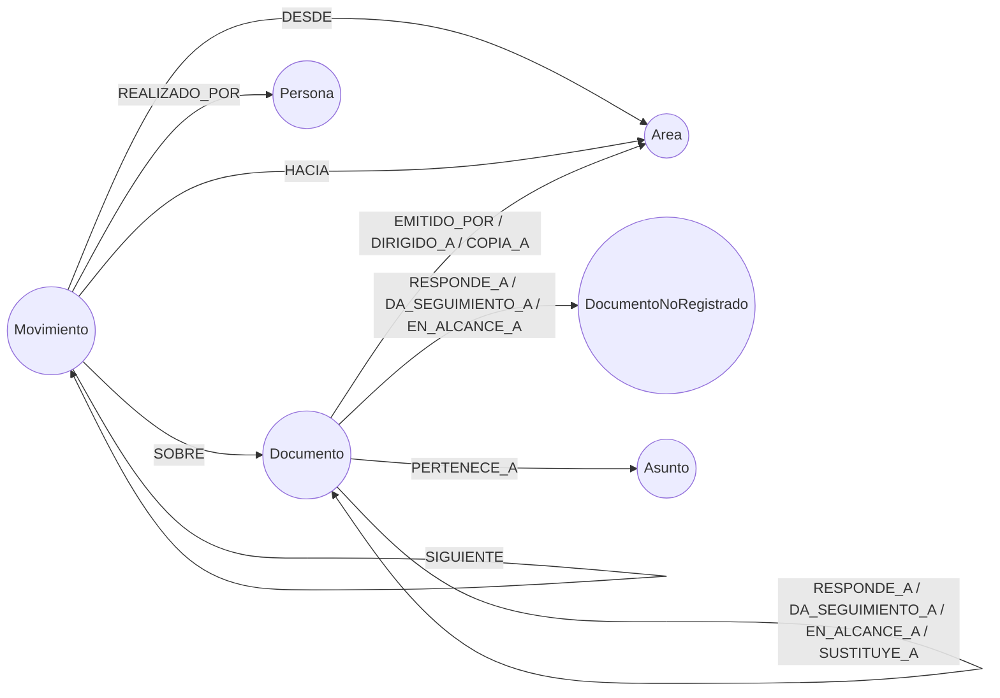

# E-2.4 Modelo de grafo (Neo4j 5.26 Community)

Fuentes: D-05, D-09, D-22, D-24, D-25, D-33, D-50, D-52, D-69, D-70, D-100, D-102, D-103; patrones AG-01 a AG-10; consultas C1, C2, C3 y C5.

El grafo conserva solo lo que se recorre y lo que no existe en otra base: **6 etiquetas y 13 relaciones** (D-22, D-100). Las réplicas (Documento, Movimiento, Area, Persona y las relaciones que vienen de PostgreSQL) solo las escribe el outbox con `MERGE` (AG-06); el backend escribe directamente únicamente Asunto, DocumentoNoRegistrado, referencias y PERTENECE_A (D-24).

## Etiquetas

| Etiqueta | Propiedades | Fuente |
|---|---|---|
| Documento | `id`, `tipo`, `estado`, `confidencial` | Réplica de PostgreSQL |
| DocumentoNoRegistrado | `numero`, `emisor` (texto) | Neo4j (D-33) |
| Movimiento | `id`, `tipo`, `fecha_hora` (DateTime), `rol`, `id_grupo_turno`, `motivo`, `id_area_sugerida`, `id_titular_al_turnar`, `id_corrige` | Réplica de PostgreSQL (D-69, D-102) |
| Area | `id`, `siglas` | Réplica de PostgreSQL |
| Persona | `id`, `nombre` | Réplica de PostgreSQL |
| Asunto | `id`, `nombre`, `descripcion`, `id_persona` (quien lo creó), `fecha_hora` | Neo4j (D-24) |

Las propiedades opcionales se omiten en lugar de guardarse nulas.

## Relaciones

| Relación | De → a | Cardinalidad | Propiedades | Fuente | La usa |
|---|---|---|---|---|---|
| EMITIDO_POR | Documento → Area | N:0..1 (los externos no la tienen, HU-EMI) | — | Réplica | C2 (descripción del hilo) |
| DIRIGIDO_A | Documento → Area | N:M | — | Réplica (HU-DEST) | — |
| COPIA_A | Documento → Area | N:M | — | Réplica (HU-DEST) | — |
| RESPONDE_A | Documento → Documento \| DocumentoNoRegistrado | N:M | `id`, `id_persona`, `fecha_hora` | Neo4j; la de una salida es réplica de `documento.id_responde_a` (D-101) | C2, O-11 |
| DA_SEGUIMIENTO_A | Documento → Documento \| DocumentoNoRegistrado | N:M | igual | Neo4j | C2, O-11 |
| EN_ALCANCE_A | Documento → Documento \| DocumentoNoRegistrado | N:M | igual | Neo4j | C2, O-11 |
| SUSTITUYE_A | Documento → Documento | N:M, solo registrados (D-33) | igual | Neo4j; cambia el estado en PostgreSQL (D-14) | C2, O-11 |
| PERTENECE_A | Documento → Asunto | N:M (D-30) | igual | Neo4j | C2, C5 |
| SOBRE | Movimiento → Documento | N:1 | — | Réplica | C1, C3, C5 |
| DESDE | Movimiento → Area | N:0..N (ninguna en `registro`, varias en `atraccion`) | — | Réplica | C1, C3 |
| HACIA | Movimiento → Area | N:1 | — | Réplica | C1, C5 |
| REALIZADO_POR | Movimiento → Persona | N:1 | — | Réplica | C1, C5 |
| SIGUIENTE | Movimiento → Movimiento | N:M | — | Se calcula al replicar (D-70, D-103) | C1 |

Ya no están en el grafo: las relaciones organizacionales (D-52), CORRIGE, FIRMADO_POR, RECIBIDO_POR y REGISTRADO_POR (D-100), FolioRecepcion y ActorExterno (D-12).



## Restricciones e índices

Se aplican desde `database/graph/schema/` (D-55):

```cypher
CREATE CONSTRAINT documento_id IF NOT EXISTS FOR (n:Documento) REQUIRE n.id IS UNIQUE;
CREATE CONSTRAINT movimiento_id IF NOT EXISTS FOR (n:Movimiento) REQUIRE n.id IS UNIQUE;
CREATE CONSTRAINT area_id IF NOT EXISTS FOR (n:Area) REQUIRE n.id IS UNIQUE;
CREATE CONSTRAINT persona_id IF NOT EXISTS FOR (n:Persona) REQUIRE n.id IS UNIQUE;
CREATE CONSTRAINT asunto_id IF NOT EXISTS FOR (n:Asunto) REQUIRE n.id IS UNIQUE;
CREATE CONSTRAINT no_registrado_numero_emisor IF NOT EXISTS
  FOR (n:DocumentoNoRegistrado) REQUIRE (n.numero, n.emisor) IS UNIQUE;
CREATE INDEX movimiento_fecha IF NOT EXISTS FOR (m:Movimiento) ON (m.fecha_hora);
CREATE INDEX referencia_id IF NOT EXISTS FOR ()-[r:RESPONDE_A]-() ON (r.id);
-- y un índice igual para DA_SEGUIMIENTO_A, EN_ALCANCE_A, SUSTITUYE_A y PERTENECE_A
```

La existencia de propiedades (`IS NOT NULL`) es exclusiva de Enterprise; en Community la garantizan el outbox y el servicio. `emisor` de DocumentoNoRegistrado se guarda normalizado (sin espacios dobles al inicio ni al final) para que la unicidad no dependa de la captura.

## Réplica desde el outbox (AG-06)

| Evento | Escritura |
|---|---|
| `area`, `persona` | `MERGE (a:Area {id}) SET a.siglas = …` / `MERGE (p:Persona {id}) SET p.nombre = …` |
| `documento` | `MERGE (d:Documento {id}) SET d.tipo, d.estado, d.confidencial`; EMITIDO_POR si el emisor es interno; en una salida con `id_responde_a`, `MERGE (d)-[:RESPONDE_A {id}]->(o)` |
| `estado` | `MATCH (d:Documento {id}) SET d.estado = …` |
| `movimiento` | `MERGE (m:Movimiento {id})` con sus propiedades, SOBRE, HACIA, REALIZADO_POR, un DESDE por cada origen y SIGUIENTE según la regla siguiente |

Todas son idempotentes. La réplica nunca borra nodos ni toca Asunto, DocumentoNoRegistrado, referencias ni PERTENECE_A (D-25).

## Regla de SIGUIENTE (D-70, D-103)

Al replicar un movimiento `M` del documento `d`, en orden de outbox (D-48):

1. `registro`: no tiene predecesor.
2. `correccion`: no se une; queda ligada al original por `id_corrige` y aparece en C1 como paso propio.
3. Para cada área `o` de origen de `M` (una, o varias en una atracción): el predecesor es el movimiento más reciente de `d`, distinto de una corrección, con `HACIA` a `o`. Si no existe, el predecesor es el movimiento más reciente de `d` que no sea corrección.
4. Se crea `MERGE (p)-[:SIGUIENTE]->(M)` por cada predecesor distinto.

```cypher
MATCH (m:Movimiento {id: $id})-[:SOBRE]->(d:Documento)
WHERE m.tipo <> 'correccion'
MATCH (m)-[:DESDE]->(o:Area)
CALL (m, d, o) {
  MATCH (p:Movimiento)-[:SOBRE]->(d)
  WHERE p.id <> m.id AND p.tipo <> 'correccion' AND p.fecha_hora < m.fecha_hora
  OPTIONAL MATCH (p)-[h:HACIA]->(o)
  RETURN p ORDER BY h IS NOT NULL DESC, p.fecha_hora DESC
  LIMIT 1
}
MERGE (p)-[:SIGUIENTE]->(m)
```

Por cada origen elige primero la última llegada a esa área y, si no hay, el movimiento más reciente del documento. Un `registro` no tiene DESDE y no produce filas. La consulta es orientativa; T-04 fija la versión probada. Efectos:

- Un turno a varias áreas crea movimientos con el mismo origen y el mismo predecesor: se abren ramas.
- Una atracción con varios orígenes se une a la última llegada a cada uno: las ramas se reúnen.
- Un turno de oficialía sobre un documento pendiente en otra área se une a la última llegada a oficialía, y la rama de la otra área sigue abierta hasta que esta lo devuelva, turne o concluya, o el documento sea atraído (D-67, D-103).

## Consultas que justifican el grafo

| Consulta | Ancla (D-50) | Recorrido |
|---|---|---|
| C1 Recorrido (AG-01) | `Documento {id}` | `(d)<-[:SOBRE]-(m)` y `SIGUIENTE*0..` entre ellos, con DESDE, HACIA y REALIZADO_POR |
| C2 Hilo de un asunto (AG-02) | `Asunto {id}` | PERTENECE_A y las cuatro referencias en ambos sentidos, hasta 6 saltos |
| C3 Rebotes (AG-03) | `Movimiento` por `fecha_hora` (índice) | Devoluciones por documento y áreas distintas (D-32) |
| C5 Alcance (AG-04) | `Asunto {id}` | Documentos → movimientos → áreas y personas |

Ninguna consulta parte de un Area (D-50).
